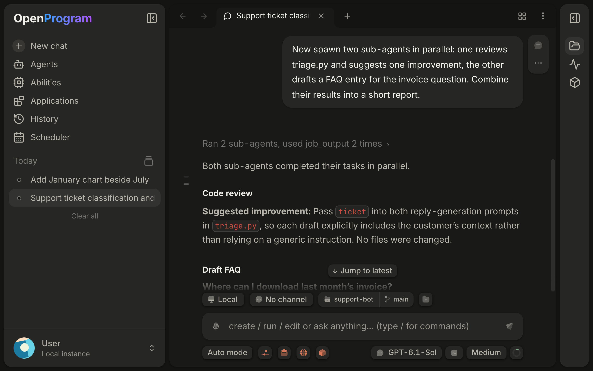

<p align="center">
  <picture>
    <source media="(prefers-color-scheme: dark)" srcset="../docs/images/logo-lockup.gif">
    <source media="(prefers-color-scheme: light)" srcset="../docs/images/logo-lockup-light.gif">
    
  </picture>
</p>

<!-- Compatibility anchors for existing incoming links. -->
<a id="1-agentic-function-the-primitive-everything-else-is-built-on"></a>
<a id="2-dag-context-for-native-multi-agent-systems"></a>
<a id="3-agentic-workflow-for-trustworthy-self-evolving-agents"></a>
<a id="4-event-infrastructure-for-proactive-agents"></a>
<a id="integrated-projects"></a>
<a id="why-openprogram"></a>
<a id="1-agentic-function--the-primitive-everything-else-is-built-on"></a>
<a id="2-dag-context--for-native-multi-agent-systems"></a>
<a id="3-agentic-workflow--for-trustworthy--self-evolving-agents"></a>
<a id="4-event-infrastructure--for-proactive-agents"></a>
<a id="also-in-the-product"></a>
<a id="quick-start"></a>
<a id="features"></a>
<a id="framework"></a>
<a id="workspace"></a>
<a id="agents-and-safety"></a>
<a id="models-and-integrations"></a>
<a id="acknowledgements"></a>

<p align="center"><b>Ein Open-Source-Agent-Harness, in dem Agenten Python-Programme sind, die sich selbst verbessern.</b></p>

<p align="center">
  <a href="https://github.com/Fzkuji/OpenProgram/releases/latest"></a>
  <a href="https://github.com/Fzkuji/OpenProgram/stargazers"></a>
  <a href="https://github.com/Fzkuji/OpenProgram/blob/main/LICENSE"></a>
  <a href="https://arxiv.org/abs/2606.15874"></a>
</p>

<p align="center">
  <a href="https://fzkuji.github.io/OpenProgram/"><b>Website</b></a> · <a href="https://fzkuji.github.io/OpenProgram/docs/"><b>Dokumentation</b></a> · <a href="https://fzkuji.github.io/OpenProgram/docs/install/download.html"><b>App herunterladen</b></a> · <a href="https://arxiv.org/abs/2606.15874"><b>Paper</b></a>
</p>

<p align="center">
  <a href="../README.md">English</a> · <a href="README.zh.md">简体中文</a> · <a href="README.zh-Hant.md">繁體中文</a> · <a href="README.ja.md">日本語</a> · <a href="README.ko.md">한국어</a> · <a href="README.es.md">Español</a> · <a href="README.fr.md">Français</a> · <a href="README.de.md">Deutsch</a> · <a href="README.pt-BR.md">Português</a> · <a href="README.ru.md">Русский</a>
</p>

<p align="center">
  <a href="https://fzkuji.github.io/OpenProgram/">
    <picture>
      <source media="(prefers-color-scheme: dark)" srcset="../docs/images/chat_hero.png">
      <source media="(prefers-color-scheme: light)" srcset="../docs/images/chat_hero_light.png">
      
    </picture>
  </a>
</p>

<a id="install"></a>

## Installation

**macOS · Linux**

```bash
curl -fsSL https://fzkuji.github.io/OpenProgram/install | sh
```

**Windows (PowerShell)**

```powershell
irm https://fzkuji.github.io/OpenProgram/install.ps1 | iex
```

**Desktop-App** — [macOS Apple Silicon](https://fzkuji.github.io/OpenProgram/docs/latest.html?OpenProgram-mac-arm64.dmg) · [macOS Intel](https://fzkuji.github.io/OpenProgram/docs/latest.html?OpenProgram-mac-x64.dmg) · [Windows](https://fzkuji.github.io/OpenProgram/docs/latest.html?OpenProgram-win-x64.exe) · [Linux (deb, AppImage)](https://fzkuji.github.io/OpenProgram/docs/install/download.html). Die App aktualisiert sich selbst.

Danach:

```bash
openprogram        # Modell verbinden, danach Chat im Terminal
openprogram web    # Arbeitsbereich unter http://localhost:18100 öffnen
```

Falls die Website nicht antwortet: `curl -fsSL https://raw.githubusercontent.com/Fzkuji/OpenProgram/main/docs/_static_root/install.sh | sh`. Weitere Optionen: [Installationsanleitung](https://fzkuji.github.io/OpenProgram/docs/install/install.html) · [Erste Schritte](https://fzkuji.github.io/OpenProgram/docs/start/GETTING_STARTED.html).

## Warum OpenProgram

<table>
<tr><td><b>Agenten sind Python-Programme</b></td><td>Verzweigungen, Wiederholungen und Prüfungen sind gewöhnlicher Code; <code>self(...)</code> ist ein Modellaufruf. Das Modell entscheidet, und Python sorgt dafür, dass die nötigen Schritte ausgeführt werden.</td></tr>
<tr><td><b>Sie programmieren sich selbst</b></td><td>Ein Agent schreibt neue Methoden in seine eigene Klasse. Ab dem nächsten Zug ist jede davon ein Werkzeug, das er aufrufen kann.</td></tr>
<tr><td><b>Ein Graph statt eines Verlaufs</b></td><td>Jeder Zug, Modellaufruf und Funktionsaufruf ist ein Knoten, den du ansehen, verzweigen und erneut abspielen kannst. Sub-Agenten arbeiten auf einem eigenen Zweig und liefern nur ihr Ergebnis.</td></tr>
<tr><td><b>Geprüfte Entscheidungen</b></td><td>Das Modell wählt aus einem festen Menü, und Code prüft die Wahl, bevor etwas ausgeführt wird.</td></tr>
<tr><td><b>Ein Arbeitsbereich</b></td><td>Chats, Dateien, Terminals und ein integrierter Browser nebeneinander, in der Desktop-App, der Weboberfläche, einer Terminal-Oberfläche oder der CLI.</td></tr>
<tr><td><b>Bedient deinen Computer</b></td><td>Steuert Desktop-Apps, Browserseiten und entfernte VMs im Hintergrund, ohne deinen Bildschirm zu übernehmen.</td></tr>
<tr><td><b>Dauerhaft aktiv</b></td><td>Geplante Aufgaben, Ziele, die Neustarts überstehen, und Chat über Telegram, Discord, Slack und WeChat.</td></tr>
<tr><td><b>Jedes Modell</b></td><td>Über 300 Anbieter und lokale Modelle; mehrere Schlüssel je Anbieter, automatisch gewechselt bei einem Limit.</td></tr>
</table>

Alle Funktionen mit ihrem Design: [Funktionsübersicht](https://fzkuji.github.io/OpenProgram/docs/reference/design/README.html).

## Auf einen Blick

```python
from openprogram import Agent

class SupportAgent(Agent):
    def triage(self, ticket: str) -> str:
        """Classify the ticket, then draft a reply."""
        kind = self(ticket, choices=["bug", "question"])
        if kind == "bug":
            logs = search_logs(ticket)  # deine eigene Hilfsfunktion
            return self(f"Reply using:\n{logs}")
        return self("Draft a short reply.")
```

Siehe [Agenten schreiben](https://fzkuji.github.io/OpenProgram/docs/capabilities/agentic-programming/writing-functions/agent.html).

## Neuigkeiten

- **2026-11-16 · [v1.4.0](https://github.com/Fzkuji/OpenProgram/releases/tag/v1.4.0)** — Mehrere Schlüssel und Anmeldungen je Anbieter mit automatischem Wechsel bei einem Limit, Aufgabenblöcke in Antworten und ein Ausführungsverlauf für geplante Aufgaben.
- **2026-11-15 · v1.3.0** — Anbieterseite mit Zustand, Kontingent und Kosten; die Agenten einer Unterhaltung in Activity aufgelistet.
- **2026-11-14 · v1.2.0** — Zweige einer Unterhaltung laufen nebeneinander, Stopp wirkt sofort, und die Windows-App ist da.

<details>
<summary>Früher</summary>

- **2026-11-10 · v1.1.0** — Zurückspulen von jeder gesendeten Nachricht aus; die App kommt auf Linux.
- **2026-11-06 · v1.0.0** — Erste Version der 1.x-Reihe: Desktop-App mit geteilten Ansichten, Computernutzung im Hintergrund, Meetings und ein dauerhaft laufender Planer.
- **2026-08-17 · v0.7.0** — Ein eingebauter Browser neben Dateien, Chat und Terminal, den Agenten lesen und bedienen können.
- **2026-03-31 · v0.1.0** — Erste öffentliche Version: agentische Funktionen, Python-Funktionen, deren Schritte ein Modell ausführt, aufgezeichnet in einem Kontextbaum.

</details>

## Zitieren

```bibtex
@inproceedings{qi2026llmascode,
  title     = {LLM-as-Code: Agentic Programming for Agent Harness},
  author    = {Qi, Junjia and Fu, Zichuan and Gao, Jingtong and Zhang, Wenlin and Yan, Hanyu and Wu, Xian and Zhao, Xiangyu},
  booktitle = {KDD 2026 Workshop on Agentic Software Engineering (AgenticSE)},
  year      = {2026},
  url       = {https://arxiv.org/abs/2606.15874},
}
```

## Mitwirken

Meldungen, Reproduktionen, Tests, Dokumentation und Code sind willkommen: [Issues](https://github.com/Fzkuji/OpenProgram/issues) · [Pull Requests](https://github.com/Fzkuji/OpenProgram/pulls) · [Leitfaden für Beiträge](../.github/CONTRIBUTING.md).

<!-- contributors-avatars -->
<p>
<a href="https://github.com/FuzzyKuji"></a>
<a href="https://github.com/Qi202"></a>
<a href="https://github.com/GithungDang"></a>
<a href="https://github.com/basil-k-aji-dev"></a>
<a href="https://github.com/binyangzhu000-sudo"></a>
</p>
<!-- /contributors-avatars -->

## Lizenz

[AGPL-3.0](../LICENSE) © 2026 FuzzyKuji.
