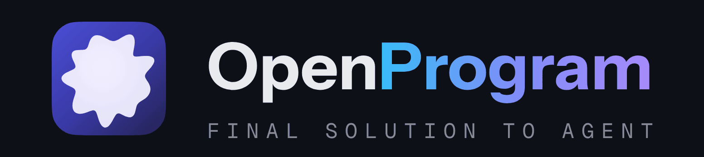
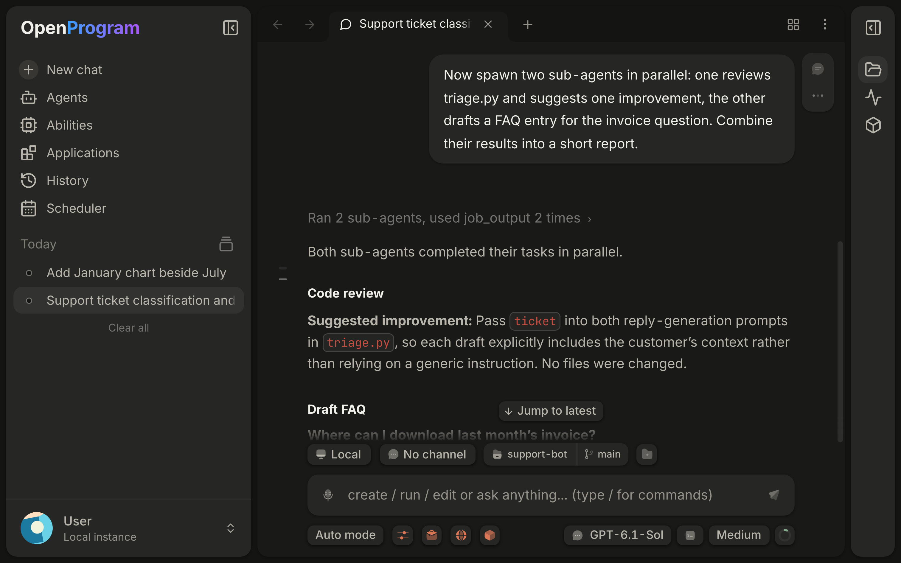

<p align="center">
  <picture>
    <source media="(prefers-color-scheme: dark)" srcset="../docs/images/logo-lockup.gif">
    <source media="(prefers-color-scheme: light)" srcset="../docs/images/logo-lockup-light.gif">
    
  </picture>
</p>

<!-- Compatibility anchors for existing incoming links. -->
<a id="1-agentic-function-the-primitive-everything-else-is-built-on"></a>
<a id="2-dag-context-for-native-multi-agent-systems"></a>
<a id="3-agentic-workflow-for-trustworthy-self-evolving-agents"></a>
<a id="4-event-infrastructure-for-proactive-agents"></a>
<a id="integrated-projects"></a>
<a id="why-openprogram"></a>
<a id="1-agentic-function--the-primitive-everything-else-is-built-on"></a>
<a id="2-dag-context--for-native-multi-agent-systems"></a>
<a id="3-agentic-workflow--for-trustworthy--self-evolving-agents"></a>
<a id="4-event-infrastructure--for-proactive-agents"></a>
<a id="also-in-the-product"></a>
<a id="quick-start"></a>
<a id="features"></a>
<a id="framework"></a>
<a id="workspace"></a>
<a id="agents-and-safety"></a>
<a id="models-and-integrations"></a>
<a id="acknowledgements"></a>

<p align="center"><b>オープンソースのエージェントハーネス。エージェントは自らを改良する Python プログラムです。</b></p>

<p align="center">
  <a href="https://github.com/Fzkuji/OpenProgram/releases/latest"></a>
  <a href="https://github.com/Fzkuji/OpenProgram/stargazers"></a>
  <a href="https://github.com/Fzkuji/OpenProgram/blob/main/LICENSE"></a>
  <a href="https://arxiv.org/abs/2606.15874"></a>
</p>

<p align="center">
  <a href="https://fzkuji.github.io/OpenProgram/"><b>ウェブサイト</b></a> · <a href="https://fzkuji.github.io/OpenProgram/docs/"><b>ドキュメント</b></a> · <a href="https://fzkuji.github.io/OpenProgram/docs/install/download.html"><b>App をダウンロード</b></a> · <a href="https://arxiv.org/abs/2606.15874"><b>論文</b></a>
</p>

<p align="center">
  <a href="../README.md">English</a> · <a href="README.zh.md">简体中文</a> · <a href="README.zh-Hant.md">繁體中文</a> · <a href="README.ja.md">日本語</a> · <a href="README.ko.md">한국어</a> · <a href="README.es.md">Español</a> · <a href="README.fr.md">Français</a> · <a href="README.de.md">Deutsch</a> · <a href="README.pt-BR.md">Português</a> · <a href="README.ru.md">Русский</a>
</p>

<p align="center">
  <a href="https://fzkuji.github.io/OpenProgram/">
    <picture>
      <source media="(prefers-color-scheme: dark)" srcset="../docs/images/chat_hero.png">
      <source media="(prefers-color-scheme: light)" srcset="../docs/images/chat_hero_light.png">
      
    </picture>
  </a>
</p>

<a id="install"></a>

## インストール

**macOS · Linux**

```bash
curl -fsSL https://fzkuji.github.io/OpenProgram/install | sh
```

**Windows（PowerShell）**

```powershell
irm https://fzkuji.github.io/OpenProgram/install.ps1 | iex
```

**デスクトップ App** — [macOS Apple Silicon](https://fzkuji.github.io/OpenProgram/docs/latest.html?OpenProgram-mac-arm64.dmg) · [macOS Intel](https://fzkuji.github.io/OpenProgram/docs/latest.html?OpenProgram-mac-x64.dmg) · [Windows](https://fzkuji.github.io/OpenProgram/docs/latest.html?OpenProgram-win-x64.exe) · [Linux（deb、AppImage）](https://fzkuji.github.io/OpenProgram/docs/install/download.html)。App は自動で更新されます。

続いて実行：

```bash
openprogram        # モデルを接続し、ターミナルでチャット
openprogram web    # ワークスペースを開く（http://localhost:18100）
```

Web サイトに接続できない場合：`curl -fsSL https://raw.githubusercontent.com/Fzkuji/OpenProgram/main/docs/_static_root/install.sh | sh`。その他の方法：[インストールガイド](https://fzkuji.github.io/OpenProgram/docs/install/install.html) · [はじめに](https://fzkuji.github.io/OpenProgram/docs/start/GETTING_STARTED.html)。

## OpenProgram を選ぶ理由

<table>
<tr><td><b>エージェントは Python プログラム</b></td><td>分岐、リトライ、チェックは普通のコードで、<code>self(...)</code> がモデル呼び出しです。判断はモデルが行い、必要な手順は Python が確実に実行します。</td></tr>
<tr><td><b>自分で自分をプログラミング</b></td><td>エージェントが自分のクラスに新しいメソッドを書き、次のターンからそれぞれが呼び出せるツールになります。</td></tr>
<tr><td><b>会話履歴ではなくグラフ</b></td><td>ターン、モデル呼び出し、関数呼び出しはすべてノードとなり、確認、分岐、再実行ができます。サブエージェントは自分のブランチで動き、結果だけを返します。</td></tr>
<tr><td><b>検証付きの判断</b></td><td>モデルは決められた選択肢から選び、実行前にコードがその選択を検証します。</td></tr>
<tr><td><b>ひとつのワークスペース</b></td><td>チャット、ファイル、ターミナル、内蔵ブラウザーを並べて表示。デスクトップ App、Web UI、TUI、CLI で使えます。</td></tr>
<tr><td><b>コンピューターを操作</b></td><td>デスクトップアプリ、ブラウザーのページ、リモート VM をバックグラウンドで操作し、画面を占有しません。</td></tr>
<tr><td><b>常駐</b></td><td>スケジュールタスク、再起動後も続くゴール、Telegram、Discord、Slack、WeChat からのチャット。</td></tr>
<tr><td><b>どのモデルでも</b></td><td>300 以上のプロバイダーとローカルモデル。プロバイダーごとに複数のキーを持ち、上限に達すると自動で切り替えます。</td></tr>
</table>

すべての機能とその設計：[機能一覧](https://fzkuji.github.io/OpenProgram/docs/reference/design/README.html)。

## ひと目でわかる

```python
from openprogram import Agent

class SupportAgent(Agent):
    def triage(self, ticket: str) -> str:
        """Classify the ticket, then draft a reply."""
        kind = self(ticket, choices=["bug", "question"])
        if kind == "bug":
            logs = search_logs(ticket)  # 自分で用意するヘルパー関数
            return self(f"Reply using:\n{logs}")
        return self("Draft a short reply.")
```

[エージェントの書き方](https://fzkuji.github.io/OpenProgram/docs/capabilities/agentic-programming/writing-functions/agent.html)を参照してください。

## ニュース

- **2026-11-16 · [v1.4.0](https://github.com/Fzkuji/OpenProgram/releases/tag/v1.4.0)** — プロバイダーごとに複数のキーとサインインを持ち、上限に達すると自動で切り替え。返信はタスクブロックにまとまり、スケジュールタスクに実行履歴が付きました。
- **2026-11-15 · v1.3.0** — 状態・クォータ・利用額を示すプロバイダーページ、会話で動くエージェントを Activity に一覧表示。
- **2026-11-14 · v1.2.0** — 1 つの会話のブランチを並行実行、停止は即時に反映、Windows App を提供。

<details>
<summary>以前のリリース</summary>

- **2026-11-10 · v1.1.0** — 送信済みの任意のメッセージから巻き戻し。App が Linux に対応。
- **2026-11-06 · v1.0.0** — 1.x 系の最初のリリース：分割ビューのデスクトップ App、バックグラウンドのコンピューター操作、会議、常駐スケジューラー。
- **2026-08-17 · v0.7.0** — ファイル、チャット、ターミナルの隣に内蔵ブラウザー。エージェントが読み取り、操作できます。
- **2026-03-31 · v0.1.0** — 最初の公開リリース：エージェント関数。モデルが各ステップを実行する Python 関数で、実行はコンテキストツリーに記録されます。

</details>

## 引用

```bibtex
@inproceedings{qi2026llmascode,
  title     = {LLM-as-Code: Agentic Programming for Agent Harness},
  author    = {Qi, Junjia and Fu, Zichuan and Gao, Jingtong and Zhang, Wenlin and Yan, Hanyu and Wu, Xian and Zhao, Xiangyu},
  booktitle = {KDD 2026 Workshop on Agentic Software Engineering (AgenticSE)},
  year      = {2026},
  url       = {https://arxiv.org/abs/2606.15874},
}
```

## コントリビュート

報告、再現、テスト、ドキュメント、コードのいずれも歓迎します：[Issues](https://github.com/Fzkuji/OpenProgram/issues) · [Pull requests](https://github.com/Fzkuji/OpenProgram/pulls) · [コントリビューションガイド](../.github/CONTRIBUTING.md)。

<!-- contributors-avatars -->
<p>
<a href="https://github.com/FuzzyKuji"></a>
<a href="https://github.com/Qi202"></a>
<a href="https://github.com/GithungDang"></a>
<a href="https://github.com/basil-k-aji-dev"></a>
<a href="https://github.com/binyangzhu000-sudo"></a>
</p>
<!-- /contributors-avatars -->

## ライセンス

[AGPL-3.0](../LICENSE) © 2026 FuzzyKuji。
