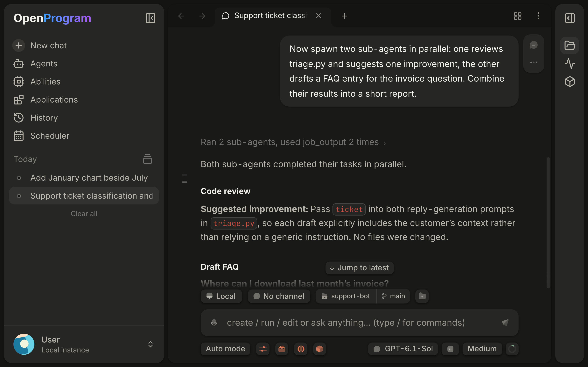

<p align="center">
  <picture>
    <source media="(prefers-color-scheme: dark)" srcset="../docs/images/logo-lockup.gif">
    <source media="(prefers-color-scheme: light)" srcset="../docs/images/logo-lockup-light.gif">
    
  </picture>
</p>

<!-- Compatibility anchors for existing incoming links. -->
<a id="1-agentic-function-the-primitive-everything-else-is-built-on"></a>
<a id="2-dag-context-for-native-multi-agent-systems"></a>
<a id="3-agentic-workflow-for-trustworthy-self-evolving-agents"></a>
<a id="4-event-infrastructure-for-proactive-agents"></a>
<a id="integrated-projects"></a>
<a id="why-openprogram"></a>
<a id="1-agentic-function--the-primitive-everything-else-is-built-on"></a>
<a id="2-dag-context--for-native-multi-agent-systems"></a>
<a id="3-agentic-workflow--for-trustworthy--self-evolving-agents"></a>
<a id="4-event-infrastructure--for-proactive-agents"></a>
<a id="also-in-the-product"></a>
<a id="quick-start"></a>
<a id="features"></a>
<a id="framework"></a>
<a id="workspace"></a>
<a id="agents-and-safety"></a>
<a id="models-and-integrations"></a>
<a id="acknowledgements"></a>

<p align="center"><b>开源 Agent Harness：Agent 就是能自我改进的 Python 程序。</b></p>

<p align="center">
  <a href="https://github.com/Fzkuji/OpenProgram/releases/latest"></a>
  <a href="https://github.com/Fzkuji/OpenProgram/stargazers"></a>
  <a href="https://github.com/Fzkuji/OpenProgram/blob/main/LICENSE"></a>
  <a href="https://arxiv.org/abs/2606.15874"></a>
</p>

<p align="center">
  <a href="https://fzkuji.github.io/OpenProgram/"><b>官网</b></a> · <a href="https://fzkuji.github.io/OpenProgram/docs/README.zh.html"><b>文档</b></a> · <a href="https://fzkuji.github.io/OpenProgram/docs/install/download.zh.html"><b>下载 App</b></a> · <a href="https://arxiv.org/abs/2606.15874"><b>论文</b></a>
</p>

<p align="center">
  <a href="../README.md">English</a> · <a href="README.zh.md">简体中文</a> · <a href="README.zh-Hant.md">繁體中文</a> · <a href="README.ja.md">日本語</a> · <a href="README.ko.md">한국어</a> · <a href="README.es.md">Español</a> · <a href="README.fr.md">Français</a> · <a href="README.de.md">Deutsch</a> · <a href="README.pt-BR.md">Português</a> · <a href="README.ru.md">Русский</a>
</p>

<p align="center">
  <a href="https://fzkuji.github.io/OpenProgram/">
    <picture>
      <source media="(prefers-color-scheme: dark)" srcset="../docs/images/chat_hero.png">
      <source media="(prefers-color-scheme: light)" srcset="../docs/images/chat_hero_light.png">
      
    </picture>
  </a>
</p>

<a id="install"></a>

## 安装

**macOS · Linux**

```bash
curl -fsSL https://fzkuji.github.io/OpenProgram/install | sh
```

**Windows（PowerShell）**

```powershell
irm https://fzkuji.github.io/OpenProgram/install.ps1 | iex
```

**桌面 App** — [macOS Apple Silicon](https://fzkuji.github.io/OpenProgram/docs/latest.html?OpenProgram-mac-arm64.dmg) · [macOS Intel](https://fzkuji.github.io/OpenProgram/docs/latest.html?OpenProgram-mac-x64.dmg) · [Windows](https://fzkuji.github.io/OpenProgram/docs/latest.html?OpenProgram-win-x64.exe) · [Linux（deb、AppImage）](https://fzkuji.github.io/OpenProgram/docs/install/download.zh.html)。App 会自动更新。

然后运行：

```bash
openprogram        # 连接模型，然后在终端里聊天
openprogram web    # 打开工作区，地址 http://localhost:18100
```

网站打不开时：`curl -fsSL https://raw.githubusercontent.com/Fzkuji/OpenProgram/main/docs/_static_root/install.sh | sh`。更多方式：[安装说明](https://fzkuji.github.io/OpenProgram/docs/install/install.zh.html) · [快速上手](https://fzkuji.github.io/OpenProgram/docs/start/GETTING_STARTED.zh.html)。

## 为什么选 OpenProgram

<table>
<tr><td><b>Agent 就是 Python 程序</b></td><td>分支、重试和检查都是普通代码；<code>self(...)</code> 是一次模型调用。模型负责判断，Python 保证必须的步骤一定执行。</td></tr>
<tr><td><b>自己给自己编程</b></td><td>Agent 往自己的类里写新方法，下一轮起每个方法都是能调用的工具。</td></tr>
<tr><td><b>是图，不是聊天记录</b></td><td>每轮对话、模型调用和函数调用都是节点，可以查看、分支和重放。子 Agent 在自己的分支上工作，只交回结果。</td></tr>
<tr><td><b>受检查的决策</b></td><td>模型从固定选项里选，代码先验证再执行。</td></tr>
<tr><td><b>一个工作区</b></td><td>聊天、文件、终端和内置浏览器并排摆开，可在桌面 App、网页界面、终端界面或 CLI 中使用。</td></tr>
<tr><td><b>操作你的电脑</b></td><td>在后台操作桌面应用、浏览器页面和远程虚拟机，不占用你的屏幕。</td></tr>
<tr><td><b>常驻运行</b></td><td>定时任务、重启后继续的目标，以及在 Telegram、Discord、Slack 和微信里对话。</td></tr>
<tr><td><b>任意模型</b></td><td>300 多个服务商和本地模型；每个服务商可放多个密钥，到限额时自动切换。</td></tr>
</table>

每项功能及其设计：[功能索引](https://fzkuji.github.io/OpenProgram/docs/reference/design/README.zh.html)。

## 一眼看懂

```python
from openprogram import Agent

class SupportAgent(Agent):
    def triage(self, ticket: str) -> str:
        """Classify the ticket, then draft a reply."""
        kind = self(ticket, choices=["bug", "question"])
        if kind == "bug":
            logs = search_logs(ticket)  # 你自己的辅助函数
            return self(f"Reply using:\n{logs}")
        return self("Draft a short reply.")
```

参见[编写 Agent](https://fzkuji.github.io/OpenProgram/docs/capabilities/agentic-programming/writing-functions/agent.zh.html)。

## 动态

- **2026-11-16 · [v1.4.0](https://github.com/Fzkuji/OpenProgram/releases/tag/v1.4.0)** — 每个服务商可放多个密钥和登录，到限额时自动切换；回复按任务分块；定时任务有运行记录。
- **2026-11-15 · v1.3.0** — 服务商页面显示健康状态、额度和花费；Activity 列出对话里在工作的 Agent。
- **2026-11-14 · v1.2.0** — 同一对话的分支可以并行运行，停止立即生效，Windows App 上线。

<details>
<summary>更早</summary>

- **2026-11-10 · v1.1.0** — 可以从任意一条已发送的消息回退；App 支持 Linux。
- **2026-11-06 · v1.0.0** — 1.x 的第一个版本：带分屏的桌面 App、后台运行的电脑操作、会议和常驻调度器。
- **2026-08-17 · v0.7.0** — 内置浏览器，与文件、对话和终端并排，Agent 可以读取并操作。
- **2026-03-31 · v0.1.0** — 第一个公开版本：Agentic 函数——由模型执行各步骤的 Python 函数，执行过程记录在上下文树中。

</details>

## 引用

```bibtex
@inproceedings{qi2026llmascode,
  title     = {LLM-as-Code: Agentic Programming for Agent Harness},
  author    = {Qi, Junjia and Fu, Zichuan and Gao, Jingtong and Zhang, Wenlin and Yan, Hanyu and Wu, Xian and Zhao, Xiangyu},
  booktitle = {KDD 2026 Workshop on Agentic Software Engineering (AgenticSE)},
  year      = {2026},
  url       = {https://arxiv.org/abs/2606.15874},
}
```

## 参与贡献

欢迎问题报告、复现、测试、文档和代码：[问题反馈](https://github.com/Fzkuji/OpenProgram/issues) · [拉取请求](https://github.com/Fzkuji/OpenProgram/pulls) · [贡献指南](../.github/CONTRIBUTING.md)。

<!-- contributors-avatars -->
<p>
<a href="https://github.com/FuzzyKuji"></a>
<a href="https://github.com/Qi202"></a>
<a href="https://github.com/GithungDang"></a>
<a href="https://github.com/basil-k-aji-dev"></a>
<a href="https://github.com/binyangzhu000-sudo"></a>
</p>
<!-- /contributors-avatars -->

## 许可证

[AGPL-3.0](../LICENSE) © 2026 FuzzyKuji。
